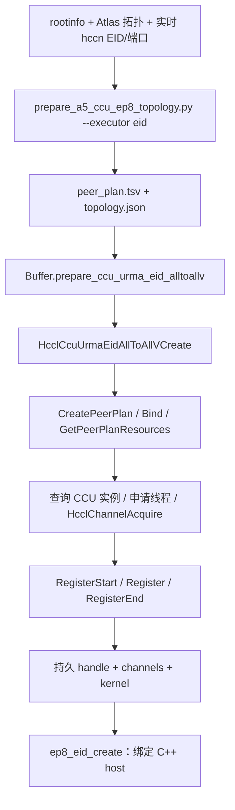

# EP8 CCU + URMA EID 多路径 AllToAllV：实现、调用链与失败分析

更新日期：2026-10-30。代码基线：`feature/a5-ccu-92-93-alltoall`，`ce130f2`。

- `f1859d2`：新增 EP8 组内 EID 转发后端，消除应用层 relay HBM 中转。
- `ce130f2`：修复 kernel 使用 CCU V1 不支持的 Sub/And 表达式导致的注册失败。
- 操作步骤见 [A5_CCU_92_93_ALLTOALL.md](A5_CCU_92_93_ALLTOALL.md) 第 11 节，当前修复后的复测入口是第 11.6 节。

本文区分代码实现、现场日志证据和尚待硬件验证的行为。当前修复已完成 CANN 9.2 容器编译与离线回归，尚未获得修复后 CANN 9.3 八卡 EID 数据正确性和性能结果。

## 1. 目标与边界

目标是在 DeepSeek V4.1 prefill MoE 中，替换 dispatch/combine 使用的 AllToAllV 通信环节。模型侧仍负责 router、token packing/unpacking、专家计算和 top-k 权重合并；本算子按调用者提供的 packed 行计数搬运数据，不计算专家选择，也不执行数值加权。

当前 EID 后端专供 EP8：

- 通信组恰好 8 个 rank；relay 只能选组内其他 6 个 rank，不能等于源或目的 rank。
- 同一原始有向流最多分为 direct 前缀和一条 relay 路径的后缀。
- 使用与原 2/4 卡显式 EID 多路径相同的端点配置机制。2/4 卡保留原有接口和算法，不应用 EP8 贪心规划。
- 9.2/9.3 是独立分支；原 9.1 分支不因本次修改而改变。
- 不在 relay 卡分配应用层 payload 中转 HBM，不调用 relay pack/forward/unpack kernel，不启动额外的两组 HCCL relay 通信域。
- 源与最终目的的数据仍在 HBM；“无 relay HBM”不表示源、目的不访问 HBM，也不对硬件内部缓存实现作承诺。

升级 wheel 本身不会切换执行后端。`ep8_pipeline_create + PipelineContext.create + attach_lane` 仍是旧 HBM 流水线；新入口是 `prepare_ccu_urma_eid_alltoallv + ep8_eid_create`。

## 2. 输入和输出契约

### 2.1 本批次真实路由矩阵

`C[s,d]` 表示源 rank `s` 发往目的 rank `d` 的 packed 行数。传入全体 rank 一致的 CPU 矩阵，按 row-major 展开为 64 个非负整数。

```text
C = [[C00, C01, ..., C07],
     [C10, C11, ..., C17],
     ...,
     [C70, C71, ..., C77]]

rank r 的 send 行数 = sum_d C[r,d]
rank r 的 recv 行数 = sum_s C[s,r]
每行字节 row_bytes = element_size × 所有尾部维度的乘积
```

send 按目的 rank 递增排列，recv 按源 rank 递增排列；源、目的偏移分别计算，self 偏移无需相等。输入/输出必须连续、同次调用 dtype 和尾部形状相同、互不重叠；允许非对称计数和零长度。

矩阵是本次真实 packed 行数，不是历史专家热度。一个 token 是否复制给多个专家、是否按目标卡合并，取决于模型 packing；不能仅凭 top-k 数量推断实际通信量。

模型只有本 rank 的 8 个发送计数时，需要另行交换计数以得到全局矩阵。当前 EID host 不内置这次 gather，也不从 NPU Tensor 隐式读取路由；测试里的 `gather_routing_counts` 在 host 之外执行。模型若已持有全局 CPU C，可以直接传入。

### 2.2 双向 dtype

同一个 host 可以在同一设备和原始 caller stream 上，顺序处理：

| 方向 | 示例 payload | row_bytes |
|---|---|---:|
| dispatch | FP8，宽度 5120 | 5120 B |
| combine | BF16，宽度 5120 | 10240 B |

host 根据 device、dtype、尾部形状建立 payload profile；行数变化不新建 profile。默认最多 4 个 profile，各保留两个一行大小的零长度 backing tensor。`Planner::WithRowBytes` 根据本次行宽重新换算按字节配置的阈值，通信域和注册的 EID plan 复用。

两个方向必须提供各自真实 counts。不能无条件将 combine 矩阵设为 dispatch 的转置，也不能跨 dtype 复用同一个 prepared 对象。FP8 按原始字节传输，不在算子内转换成 BF16。

例如 9072 个 packed 行，dispatch 总 payload 为 46,448,640 B，combine 为 92,897,280 B；这包含矩阵定义范围内的 self 行。实际跨卡总量应按 `sum(s != d, C[s,d]) × row_bytes` 统计。

## 3. 启动期：生成候选目录、建立通道、注册 kernel



### 3.1 候选目录不是每批次的流量计划

`prepare_a5_ccu_ep8_topology.py --executor eid` 联合验证 rootinfo、Atlas UB_CTP 边和 live hccn 信息，输出：

- `peer_plan.tsv`：源/目的 rank 与物理卡映射、direct/relay、relay 物理卡、direct route ordinal、端点 EID 和 IO die。
- `topology.json`：`version=2`、`executor=participant_eid_ccu_urma`、64 项 `allowed_relays`、候选证据、排除原因、rank die 和通道数量。

只有符合实际端口/EID、plane/net-instance、relay 同 die 及两端 rank 固定 IO die 条件的唯一候选被纳入；缺失或歧义候选被排除。运行时还核对 communicator 的物理卡映射和 direct EID，不能用“full mesh”假设代替验证。

默认每对 rank 最多 6 个 relay。完整目录为 28 个无向 rank 对 × 7 条路径 = 196 条 manifest 记录；每 rank 实际建立 7 个 peer × 7 条路径 = 49 个端到端 channel。目录不足时通道更少。`max-relays-per-peer` 可以限制候选数，不能据此宣称与完整目录等价。

### 3.2 EID 转发的实际含义

对于 `s → k → d`，通道逻辑对端仍是最终目的 `d`。代码在 direct CommLink 描述基础上，将本地/远端 EID 换成生成器验证的 relay 路径端点；反向 rank 对调两个端点。

源端 CCU 最终执行的是对 `d` 接收地址的 end-to-end Write，而不是先向 `k` 的应用 Tensor 写入，再让 `k` 执行第二跳 Write。物理转发依赖这对 EID 对应的 URMA/互联路径。relay 卡同时参与本组自己的通信，但不需要为其他流执行应用层中转算子。

### 3.3 一次初始化保留什么

复用模型原有 EP communicator 的 CCU 实例，先申请线程，再申请通道，最后完成公开 API 的 Start/Register/End 注册。实例由 communicator 管理，不由本算子另行 Assign/Destroy。

host 绑定一个原始 caller stream。若选定的 IO die 需要另一 route stream，route 层可创建 slave stream，并用事件桥接 caller 与 route 的顺序；这是同一通信域内部的线程/stream 配合，不是旧 HBM 后端的两个 relay 子通信组。

重复 `run()` 不重新创建通信域、channel 或注册 kernel。planId 用于通信域内计划标识及复用校验，不是选择物理路由的开关；同 id 不允许混用不同 manifest/后端。

## 4. 每次调用链

### 4.1 dynamic

```text
模型 router / packing 得到实际 C、send、recv
  → Python host.run(C, send, recv)
  → HostCounts：将 host 输入转换为固定 64 项矩阵
  → EidHost::Run
      → Select：选择 dtype / 行形状 profile
      → Planner::MakeInto：本次 C 的单 relay 贪心规划
      → Validate：dtype、行数、布局、地址不重叠检查
      → NpuEidRuntime::Transfer
  → deep_ep.cpp::SubmitEidTransfer
  → HcclCcuUrmaEidAllToAllVExecute
  → ExecuteAllToAllV
      → 查找 handle、已绑定 stream 和资源
      → BuildEidAllToAllVLayout
      → HcommCcuGetMemToken：获取本次 send/recv 内存 token
      → caller / route stream 顺序桥接（需要时）
  → a5ccu::LaunchKernel / EidAllToAllVKernel::GeneArgs
  → HcommCcuKernelLaunch(thread, kernel, 46 个参数)
  → CCU 元数据交换、direct/relay Write、自拷贝及完成握手
```

规划、字节偏移布局和提交在 C++ 内完成；Python 仍有入口转换开销。注册资源被复用，但每次调用仍进行布局校验、内存 token 查询和参数构造，不能把“注册一次”理解为后续没有 host 开销。

### 4.2 prepared

```python
prepared = host.prepare(C, send_example)
# C、dtype、device、尾部形状及行数保持匹配时复用：
host.execute(prepared, send, recv)
```

prepared 复用贪心决策和 host payload 元数据；route 层执行时仍构造/校验布局、查询 token、生成 task args 并提交。它不等于只测设备 kernel。

`host.run()` 返回的内部时间段是 host 侧耗时，不保证设备已完成。测试的 prepared/dynamic 端到端时间额外等待完成；dynamic 基线和多路径使用相同的计数 gather/D2H 口径。模型接入时依赖原始 stream 顺序，并保证张量在异步执行完成前有效。

## 5. 选路算法：每条原始流最多一个 relay

当前新 EID 入口使用 `RelayPlanner` 对应的 C++ `Planner::MakeInto`。没有调用旧流水线的 `FastRelayPlanner` 成本准入回退，也没有求解凸优化或搜索目标 T。

### 5.1 负载模型

使用行数作为统一负载单位：`L[s,d] = C[s,d]`，对角线置零。一条流转移 `x` 行到 `s → k → d` 后：

```text
L[s,d] -= x
L[s,k] += x
L[k,d] += x
```

`L` 包含前面决策产生的转发负载；能转移的 payload 仍只来自该原始流的 C。每条原始流最多选择一次，不递归分流 transit payload。

对一个候选 relay：

```text
a = L[s,d]
h = max(L[s,k], L[k,d])
x = min(C[s,d], floor((a-h)/2), relay_remaining_capacity[k])
gain = a - max(a-x, h+x)
```

只在 `a > h`、`x` 达到最小行数、gain 为正且达到最小字节收益时接受。这里的 `gain` 是三条受影响边的局部峰值下降，不是端到端时间收益；另有全局瓶颈时，全网最大值可能不下降。

### 5.2 与代码一致的伪代码

```python
L = C.copy()
set_diagonal(L, 0)
relay = [-1] * 64
moved = [0] * 64
used = [0] * 8

for _ in range(max_actions):       # 默认 56；每次最多确定一个原始流
    best = None
    for (s, d) in ascending_flows:
        if C[s,d] == 0 or relay[s,d] != -1:
            continue
        for k in allowed_relays[s,d]:
            a = L[s,d]
            h = max(L[s,k], L[k,d])
            if a <= h:
                continue
            x = min(C[s,d], (a-h)//2, capacity[k]-used[k])
            gain = a - max(a-x, h+x)
            if x < min_rows or gain <= 0 or gain*row_bytes < min_gain_bytes:
                continue
            # 优先 a 大，其次 gain 大；并列保持较小的 (s,d,k)。
            best = choose_by_load_then_gain(best, (s,d,k,x,gain,a))

    if best is None:
        break                     # 不存在合格分流，立即提前结束
    s,d,k,x,gain,a = best
    relay[s,d], moved[s,d] = k,x
    used[k] += x
    L[s,d] -= x
    L[s,k] += x
    L[k,d] += x
```

固定数组扫描，最坏候选评估上界为 `56 × 56 × 6 = 18,816`；实际会跳过已选流、无候选流并做负载剪枝。一般 N 卡表达为 `O(A·N³)`，当 `A=O(N²)` 时是 `O(N⁵)`；EP8 的 N 固定为 8。它是逐步贪心，不枚举所有流的 relay 组合。

默认 `min_chunk_bytes=1`、`min_gain_bytes=0`、`max_actions=56`。此处 min_chunk 是最小分流 payload 门槛，不是 EID 传输的 HBM chunk 大小。可选 `relay_capacity_bytes` 是每个 relay 的转发 payload 预算，不是申请 relay scratch HBM 的容量。

### 5.3 示例与收益限制

若只有 `0 → 4` 发送 32 MiB，并且 `0 → 7`、`7 → 4` 空闲且 EID 候选有效，可以分成 direct 16 MiB 与 relay 16 MiB。代理负载峰值从 32 MiB 变成 16 MiB，累计边流量从 32 MiB 增至 48 MiB。

这不等于耗时减半：两跳时延、共享 IO die/端口、内存带宽、元数据通知及提交成本都会影响结果。当前规划器按有向卡间边累计负载，没有完整建模所有物理共享资源和端到端时间；也不求全网 cut 下界。某些 case 选中 relay 仍可能变慢。

无 relay 时，EID host 在自己的 direct channels 上执行，不自动转调原生 HCCL。原生 HCCL AllToAllV 是独立性能基线。

## 6. 布局与 CCU 执行

源偏移与目的偏移分别为：

```text
src_offset(s,d) = sum(j < d, C[s,j]) × row_bytes
 dst_offset(s,d) = sum(i < s, C[i,d]) × row_bytes
```

若某流转发 `moved[s,d]` 行：

- direct 写该流前缀 `[0, C-moved)`。
- relay 写后缀 `[C-moved, C)`，目的地址同样增加前缀字节数。
- 两条路径写最终接收缓冲区的不重叠区间，无需 relay scratch 或最终拼接 copy。

对于每个 `(peer, relay)` channel，active 条件是“本 rank 在该路径有发送，或对端在该路径向本 rank 有发送”。因此正反方向可以选择不同 relay，只有接收的 rank 也参与对应 metadata 和完成握手。

kernel 的执行顺序是：

1. 加载 46 个参数，解码 active mask。
2. 对所有 active channels 发布最终接收地址与 token，然后等待相应对端信息。
3. 提交 direct 和选中 relay 的非阻塞 Write；不在每条 Write 后立刻等待它完成。
4. 对 self 段执行 CCU grouped local copy，源/目的 self 偏移独立。
5. 等待本 rank 已发起的 Write 完成。
6. 对 active channels 发送完成通知，再等待对端通知，结束本次通信 epoch。

这里 direct 和 relay 在同一次 kernel 内有并发执行的机会，没有旧版本“first hop 完整执行，再 second hop”的应用级屏障；实际重叠和吞吐仍需硬件测量。

46 个参数组成：`4` 个地址/token + `2` 个 self 偏移 + `4` 个 self-copy go 参数 + `1` 个 active mask + `7×5` 个 peer 参数。修复后设备实际接收的每 peer 参数是：源偏移、最终目的偏移、direct 字节数、relay 字节数、relay rank。host layout 内仍保留 total 字节数，在 `GeneArgs` 中转换为 direct 字节数。

## 7. 生命周期与关闭契约

同一个 host 可顺序服务 FP8 dispatch 和 BF16 combine，但不允许并发调用或更换设备/caller stream。prepare 返回对象与该 host 绑定；执行失败后 host 标记 poisoned，不自动重试已部分提交的操作。

| 对象 | 所有权和清理责任 |
|---|---|
| 模型 EP communicator | 模型/框架拥有，算子借用 |
| EID plan handle | 创建它的适配层负责调用 `HcclCcuUrmaPeerPlanDestroy`，且只销毁一次 |
| host payload profiles / 零长度 backing | host 管理，正常 `close()` 同步后清理 |
| caller stream | Torch 管理；调用者确保底层 runtime 在清理期间仍有效 |
| route thread/channel/kernel 资源 | 与 communicator/SDK 资源管理关联；不能仅因 host 引用释放就认定全部销毁 |

正常顺序：停止新提交和并发使用 → 所有借用者 `host.close()` → 释放 prepared/host/runtime 引用 → destroy handle → 框架销毁 EP 通信域及 NPU runtime。

`host.close()` 不销毁 handle。stream 和通信域至少存活到 close 返回，并应覆盖 host/runtime 对象清理。保留 Python stream 引用不能阻止 Torch 的全局 runtime teardown。

不能依赖 `__del__` 在进程退出后同步设备。若 close 同步失败，不能按正常完成继续在 `finally` 中拆通信域；当前实现仍可能在析构时重试 close，异常退出的安全释放及此前 double-free 根因尚未完成验证。本次 Sub/And 修复不解决该独立问题。

## 8. 之前为什么没有跑起来

### 8.1 本次 EID 注册失败：证据和代码原因

现场 CANN 9.3.0、`f1859d2` 的日志顺序：

```text
EP8_TOPOLOGY_PASS ... executor=participant_eid_ccu_urma
PEER_PLAN_ACQUIRE rank=7 channels=49 status=0
PEER_PATH_CHANNEL ... state=0          # 49 条
PUBLIC_CCU_BUILD_FAILED error=Ccu api exception:
    [GetInstrCount] Unsupported repType[11]
HcclCcuUrmaEidAllToAllVCreate → 4
深度学习扩展 deep_ep.cpp:956 → HCCL_CHECK(status)
```

这次故障位于 kernel 构图/注册，通道已建立。不是 FP8 数值运算错误，不是 `deep_ep.cpp:956` 本身构造了错误，也不是仅凭存在 Create 符号就能排除的运行时兼容性问题。

核对开发容器 9.2 SDK，`CcuRepSub::SetCommonInfo` 将类型设为 11；其 V1 指令生成器不支持 Sub 和 And，而公开 Variable 头文件仍声明了这些操作。EID kernel 新增：

```cpp
// f1859d2
 direct[j] = peer[j][2] - peer[j][3]; // Sub，首先触发 repType[11]
 live[i] = active & bit;             // And，同类后续兼容性风险
```

旧 HBM/direct kernel 从 CPU 获取字节数，没有这两个新表达式，所以它能运行不能证明新 EID kernel 可注册。这里的 V1/V2 是 CCU 指令生成器能力，不等于 CANN 9.1/9.2 的版本编号；不能概括成“CANN 9.3 没有 CCU/EID 接口”。

### 8.2 ce130f2 如何修复

- CPU `GeneArgs` 计算 `total-relay`，占用原来的 total 参数槽，不增加 task args。
- active mask 按高位到低位解码。每位先置 0；剩余 mask 大于等于该位值时置 1，并加上 CPU 预计算的 `uint64_t(0)-bit`，用 64 位模加法清除该位。不产生设备 Sub/And。
- 保留 49-channel 目录、46 task args、一次 kernel launch、组内 EID 转发。
- 增加 `A5CcuEidV1CompatAbiVersion=1`，新测试在建链前拒绝误加载旧 route 包。
- 增加 `CCU_CREATE_STAGE_BEGIN/OK/FAILED/EXCEPTION`，细分实例、线程、channel 和注册 Start/Register/End；原始返回码原样保留，不自动重试。

### 8.3 模型未就绪、旧适配层和 close 崩溃是另一组问题

此前用户提供的模型适配代码调用的是 `ep8_pipeline_create` 和三条 lane，而非 `ep8_eid_create`。因此不能把本次独立 EID 测试的注册失败，直接倒推成那次模型服务 25 分钟未就绪的唯一原因。

那次时间线已修正为用户手动 SIGTERM 后，才发生 `EP8_CPP_CLOSE_FAILED`、已销毁 stream 的 synchronize 错误和 `double free`。无 AllToAllV 执行记录，也不能证明不存在初始化/prepared 资源。

已确认的是后端选择和关闭时序需要遵守契约；尚未确认的是未就绪的具体原因及 double-free 的内存根因。模型加载慢只是猜测，需要 HTTP 状态/响应体和初始化进度证据。

更早 HBM 后端的分块多次 launch、pack/unpack、dynamic workspace 和 DFX 故障属于历史实现路径，不应混为本次 `repType[11]` 的原因，也不能把旧后端的性能收益或正确性 PASS 继承给新 EID 后端。

## 9. 验证状态和复测顺序

截至本文基线：

| 验证项 | 状态 |
|---|---|
| 现场 f1859d2 拓扑生成、49 通道申请 | 日志证据通过；随后 kernel 构图失败 |
| ce130f2 在 cam_lyw_92 / CANN 9.2 编译、严格链接、加载 | 通过，包括新的兼容标记 |
| CPU 回归 | 12 组 69 项通过 |
| 受限指令模型 | 拒绝 Sub/And；旧代码在 Sub 失败，新代码通过 |
| 掩码和指令图 | 202 种掩码含 bit 48；100 epochs × 8 ranks，通过 |
| FP8/BF16 host | 5120/10240 B 行宽交替 100 次，通过 |
| 修复后现场 CANN 9.3 八卡注册/数据/长跑 | 待复测 |
| EID 新后端模型收益、close/double-free 修复 | 未证明 |

开发验证记录：`/home/liuyuanwen/profiling/a5-ep8-eid-v1-fix/`。包含 `route-final.log`、`cpu-suite.log`、`before-v1.log`、`sdk-instruction-evidence.txt`。

新机先按操作文档第 3 节用目标 CANN 重建并安装 route 包；已有 `f1859d2` wheel 可保留，本修复不改变其调用 ABI。按第 11.2 节配置机器环境后执行：

```bash
cd /home/l00934901/sgl-kernel-npu
bash scripts/run_a5_ccu_eid_alltoallv.sh --suite create
```

预期 `EP8_EID_CREATE_ALL_RANKS_AND_EXIT_PASS`。此步骤仍使用八卡完成通信组初始化、配置一致性检查、建链和注册，但不执行 payload AllToAllV；不能当作数据正确性 PASS。

然后按第 11.2 节执行 FP8/BF16、7 case、非对称/零长度/连续提交与长跑验证，再按第 11.3 节比较 native/direct/multipath。测试结果保存在 `/home/l00934901/profiling`。当前测试三种 mode 都共享初始化及正确性预检框架，`--mode native` 也不是绕过 EID 注册的独立诊断程序。

若只注册仍失败，保留新目录的 topology.log、manifest、topology.json 和 run.log。日志中的 manifest 绝对路径、SHA256、失败 stage 与 SDK 异常比通用返回码 4 更有诊断价值。

## 10. 代码入口索引

以下路径均相对算子仓库根目录：

| 文件 | 职责 |
|---|---|
| [prepare_a5_ccu_ep8_topology.py](../scripts/prepare_a5_ccu_ep8_topology.py) | 生成 EID manifest 和候选证据 |
| [heuristic_alltoallv.py](../python/deep_ep/deep_ep/heuristic_alltoallv.py) | RelayPlanner Python 包装、参考实现、计数辅助 |
| [ep8_relay_planner.hpp](../csrc/deepep/ep8_relay_planner.hpp) | C++ 单 relay 贪心；其中 HBM Layout/Chunk 方法不被 EID host 使用 |
| [ep8_eid_host.hpp](../csrc/deepep/ep8_eid_host.hpp) | dynamic/prepared、payload profile、校验和生命周期 |
| [ep8_eid_bindings.hpp](../csrc/deepep/ep8_eid_bindings.hpp) | pybind 入口、原始 stream 约束、NpuEidRuntime |
| [deep_ep.cpp](../csrc/deepep/deep_ep.cpp) | Buffer 创建接口、route 符号解析和 SubmitEidTransfer |
| [peer_plan_runtime.cc](../examples/a5_ccu_urma_route_probe/op_host/peer_plan_runtime.cc) | Create/Bind/Execute/Sync/Destroy、运行时布局与顺序桥接 |
| [utils.cc](../examples/a5_ccu_urma_route_probe/op_host/utils.cc) | 端点核对和覆盖、线程/channel 申请、kernel 注册入口 |
| [public_ccu.cc](../examples/a5_ccu_urma_route_probe/op_host/public_ccu.cc) | 9.2/9.3 公开注册和启动 API 适配 |
| [eid_alltoallv_layout.h](../examples/a5_ccu_urma_route_probe/common/eid_alltoallv_layout.h) | direct/relay 地址区间、active mask、策略校验 |
| [eid_alltoallv_kernel.cc](../examples/a5_ccu_urma_route_probe/op_kernel_ccu/eid_alltoallv_kernel.cc) | CCU 指令图与 46 参数构造 |
| [test_a5_ccu_eid_npu.py](../tests/python/deepep/test_a5_ccu_eid_npu.py) | create/correctness/benchmark 和双向测试 |
